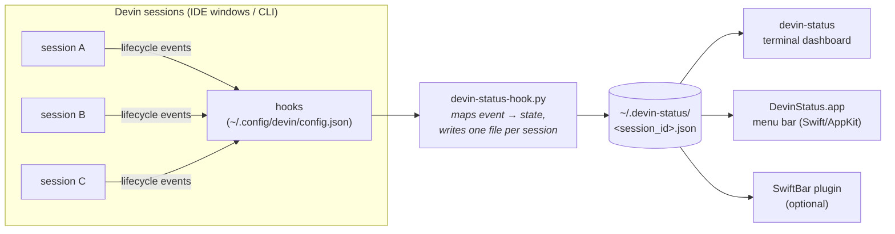

# devin-session-monitor

See at a glance which of your [Devin](https://devin.ai) agent sessions are working, and which are **waiting for you** — from a macOS menu bar app, a terminal dashboard, or a SwiftBar plugin.


<!-- TODO: replace with a real screenshot of the menu bar + dropdown -->

---

## The problem

When you run several Devin sessions at once (in Devin Desktop or the CLI), there's no easy way to tell which ones are still churning through tools and which ones finished their turn and are silently waiting for input, a permission approval, or an answer to a question. This project adds a lightweight status channel for exactly that.

## Architecture



Devin's lifecycle hooks (`SessionStart`, `UserPromptSubmit`, `PreToolUse`, `PostToolUse`, `PermissionRequest`, `Stop`, `SessionEnd`, `PostCompaction`) receive a JSON payload on stdin and can run any shell command. A single Python hook script maps each event to a session state and writes a tiny JSON file per session. All UIs just read that directory — the hook never blocks the agent and requires no daemon.

## States

| Dot | State | Meaning |
|-----|-------|---------|
| 🟢 | `working` | agent is actively running tools / generating |
| 🟡 | `waiting` | turn finished — session is waiting for your next prompt |
| 🟠 | `permission` | a tool call needs your approval |
| 🔵 | `question` | an `ask_user_question` dialog is open |
| ⚪ | `starting` | session just started |
| 🔴 | `[stale?]` | `working` with no events for >10 min — possibly hung |

## Example status file

One file per session, written atomically (`~/.devin-status/<session_id>.json`):

```json
{
  "session_id": "demo-alpha-7",
  "state": "waiting",
  "ts": 1793217051.87,
  "tool": "Stop",
  "project": "example-app",
  "created": 1793216931.87
}
```

`project` comes from the `DEVIN_PROJECT_DIR` env var that Devin sets for hook commands. `ts` is updated on every tool call, so consumers can detect stale sessions by age. Files older than 24h are garbage-collected by the hook itself.

## Components

| File | Purpose |
|------|---------|
| `hooks/devin-status-hook.py` | stdin JSON → state file. Registered once for all hook events |
| `bin/devin-status` | live terminal dashboard (colors, age, last tool) |
| `menubar-app/main.swift` | ~100-line AppKit menu bar app — colored dot per session, dropdown with details |
| `swiftbar/devin-status.5s.sh` | alternative menu bar widget for [SwiftBar](https://github.com/swiftbar/SwiftBar) |
| `config-example.json` | the `hooks` block to merge into `~/.config/devin/config.json` |
| `install.sh` | one-shot installer (copies scripts, merges hooks with backup, builds the app) |

## Install

```bash
git clone https://github.com/plusz/devin-session-monitor
cd devin-session-monitor
./install.sh
```

The installer:

1. copies the hook script and dashboard to `~/.config/devin/`
2. merges the `hooks` block into `~/.config/devin/config.json` (**backs up** your existing config first)
3. builds `~/Applications/DevinStatus.app` via `swiftc` (skipped if Xcode tools are absent — the CLI dashboard still works)
4. symlinks `devin-status` into `/opt/homebrew/bin`

Manual install: copy `hooks/devin-status-hook.py` somewhere, then merge `config-example.json` into `~/.config/devin/config.json` under a `"hooks"` key, adjusting the command path.

## Usage

- `devin-status` — terminal dashboard, refreshes every 2s
- `open ~/Applications/DevinStatus.app` — menu bar dots; click for per-session details. Add it to **System Settings → General → Login Items** for autostart
- SwiftBar: `brew install --cask swiftbar`, then point its plugin folder at `swiftbar/` (or symlink the file)

## Verify

1. Open a **new** Devin session and send any prompt.
2. `ls ~/.devin-status/` — a `<session>.json` should appear.
3. The menu bar icon and dashboard should reflect it within seconds.

## Limitations

- **Hooks load at session start.** Sessions that were already running before install won't report — restart them (or use Devin's `/handoff` to move their context into a new session).
- State is a best-effort heartbeat, not a control channel — e.g. a session killed without `SessionEnd` leaves a stale file until GC (24h).
- The hook spawns `python3` per tool call (~30–50 ms); imperceptible next to model latency.
- macOS only (menu bar app, SwiftBar). The hook itself is POSIX — a Linux/Windows frontend could reuse `~/.devin-status/`.
- Works with Devin Desktop (IDE) sessions and the Devin CLI — verified on Devin Desktop as of Oct 2026.

## Security notes

- Status files contain no conversation content — only session id, state, timestamps, project dir name, and last tool name.
- The hook returns nothing to the agent and never blocks (`exit 0` semantics); it can't interfere with tool calls.

## License

MIT — see [LICENSE](LICENSE).
